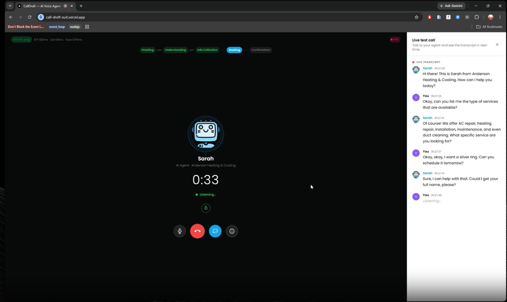
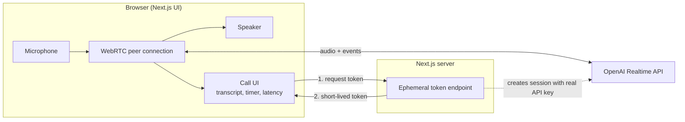
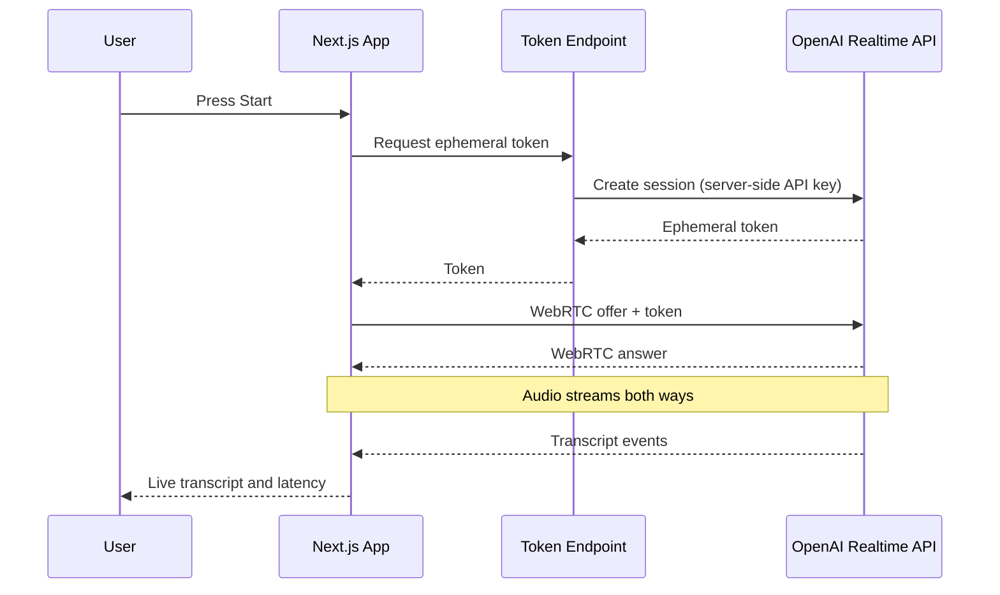

# CallDraft: AI Voice Agent

A browser-based AI voice agent. Click start, talk, and get spoken replies back in real time, like a phone call with an AI that runs in a tab. No install, no plugins.

Built with Next.js, TypeScript, the OpenAI Realtime API and WebRTC, with replies starting in under 800ms.

**Live demo:** [call-draft-suit.vercel.app](https://call-draft-suit.vercel.app/)



## Features

- **Live speech-to-speech conversation:** the AI listens and answers by voice, with no separate speech-to-text and text-to-speech steps in between
- **Low latency:** responses begin in under 800ms
- **Live transcript:** see what you and the AI say as it happens
- **Call timer and latency indicator:** a running timer and a live read of response time
- **Short-lived token auth:** the browser never sees the real OpenAI API key
- **Clean, minimal UI:** one screen, one button to start

## How It Works

### Architecture



### Connection flow



### Step by step

1. You press **Start**. The app asks its server for an ephemeral token.
2. The server uses the real API key to create that token, and the browser receives only the short-lived one.
3. The browser opens a WebRTC connection straight to the Realtime API, so audio does not pass through my backend.
4. Audio streams both ways, and transcript events update the UI as they arrive.

## Design Decisions

- **WebRTC instead of WebSockets for audio.** WebRTC is built for real-time media: jitter buffering, echo cancellation and packet-loss handling come with the browser.
- **Ephemeral tokens.** A frontend-only integration would expose the OpenAI key. A short-lived token created by the server keeps the real key private.
- **Direct connection to the Realtime API.** Fewer hops means lower latency, and the server stays light because it never relays audio.

## Tech Stack

| Area | Tools |
| --- | --- |
| Framework | Next.js, React, TypeScript |
| Voice and AI | OpenAI Realtime API |
| Real-time transport | WebRTC |
| Auth | Ephemeral session tokens |

## Getting Started

```bash
git clone [add repo url]
cd [repo folder]
npm install
cp .env.example .env.local   # add your OPENAI_API_KEY
npm run dev
```

Open http://localhost:3000, allow microphone access, and press start.

> Use headphones when testing locally. Speaker audio can feed back into the microphone.

## What I Built

The whole app: the WebRTC connection, the Realtime API integration, the ephemeral-token endpoint, the live transcript, and the call timer and latency indicator.

## Author

**Sher Muhammad Iqbal**: [Portfolio](https://shermuhammad.vercel.app) · [LinkedIn](https://www.linkedin.com/in/sher-muhammad-448588290)
